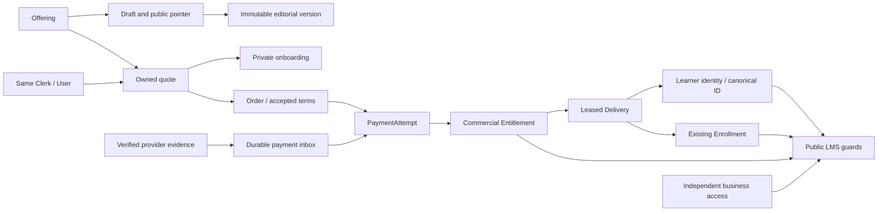

# Marketplace V1 architecture and recovery runbook

M6 engineering candidate on `marketplace-v1`, based on approved M5 `092462c`. This document contains future operator instructions, not authorization to execute them. No Production provider/database/DNS/deployment operation was performed. Real Razorpay Test Mode acceptance is a separate gate.

## Product flow and authoritative state

Browse → account → owned pre-payment quote → onboarding → accepted purchase terms → Order → provider session → independently verified captured evidence → commercial ownership → durable delivery → learner prerequisites → existing Course Enrollment → My Programs → Continue Learning. Refund/reversal removes the relevant commercial grant while preserving records/history.

| State/model                     | Authority                                                                                                                             |
| ------------------------------- | ------------------------------------------------------------------------------------------------------------------------------------- |
| MarketplaceOffering             | Current publication, sale availability, new-intent integer price/currency and delivery/LMS configuration.                             |
| MarketplaceOfferingPage         | Mutable Admin draft and same-Offering published-version pointer. Draft is never public content authority.                             |
| MarketplaceOfferingPageVersion  | Immutable published editorial snapshot. Invalid snapshot never falls back to draft.                                                   |
| MarketplaceEnrollmentIntent     | Private pre-payment quote snapshot, expiry, revision and owner/browser-proof binding.                                                 |
| MarketplaceEnrollmentOnboarding | Per-intent private answers/completed consent; not StudentProfile or learning authority.                                               |
| MarketplaceOrder                | Immutable financial commitment, quote and accepted purchase-terms version. PAID alone is not access authority.                        |
| MarketplacePaymentAttempt       | One provider checkout Order per local Order, persisted UUID receipt, merchant/session/transaction bindings.                           |
| MarketplacePaymentEvent         | Authenticated raw-body digest/normalized durable inbox; no full provider payload.                                                     |
| MarketplaceEntitlement          | Sole commercial ownership authority. ACTIVE comes from verified settlement, never browser flags.                                      |
| MarketplaceDelivery             | Durable lease/retry/provisioning lifecycle; immutable Course, learner/account and Enrollment provenance.                              |
| MarketplaceLearnerIdentity      | Retained identity/provenance only, alongside existing persona. Alone grants no access.                                                |
| Enrollment                      | Existing unique User/Course learning record and academic history.                                                                     |
| User / Student ID               | Same unique Clerk mapping; preserved primary persona/platform roles. Canonical PostgreSQL issuer/sequence generates immutable ST IDs. |
| StudentProfile                  | Optional one-to-one education profile; no automatic Marketplace overwrite or requirement.                                             |

Public LMS authorization: Clerk session → persisted User → learner identity + canonical Student ID → independent business authorization OR initialized ACTIVE LMS Delivery with ACTIVE Entitlement → appropriate Enrollment → published Course/Section/item → applicable exact Batch/private media rules. Explicit administrative DISABLED wins over both account-level authorization sources. Canonical provisioning validates prerequisites directly while PROVISIONING and atomically completes identity/ID/provenance/Enrollment before ACTIVE; it never weakens the public gate to bootstrap itself.

## Intent, quote and publication semantics

Starts serialize by persisted actor or server-issued anonymous proof plus Offering. Anonymous claims also coordinate on the target actor/Offering. A compatible existing owned quote is reused without overwriting onboarding; redundant anonymous intents are claimed/retired atomically with existing append-only audit, and canonical recovery survives response loss/refresh. Another user's record/proof cannot select that canonical destination. Only the exact same commercial quote is compatible.

Terminal financial commitments (REFUNDED/CANCELLED/EXPIRED) are excluded from compatible intent reuse. A legitimate repurchase gets a fresh financial intent/Order while keeping the learner ID and Enrollment history. Uncertain, REVIEW and REFUND_PENDING commitments remain protected against overlapping payment attempts.

New Order/session creation rechecks published OPEN availability and non-TBA price. Existing Intent/Order prices are snapshotted; current price edits do not reprice them. Once a provider commitment exists, its verified captured evidence is evaluated against its immutable quote even if catalogue/editorial publication changes afterward. Expired/otherwise ineligible captured money is retained in REVIEW without automatic ownership. Editorial publish has no authority over accepted financial quotes. LMS delivery configuration is pinned at paid Delivery initialization, not represented as a second quote field; later catalogue edits cannot silently rebind an already provisioned Delivery.

## Money, free programs and legal gate

Money uses integer minor units with an application maximum of 2147483647, never client amounts or floating arithmetic. The initial adapter admits INR only, minimum 100 paise; no conversion. The application integer ceiling is not a promise of a merchant/provider transaction limit. External acceptance must confirm actual merchant limits. See [Razorpay's official Orders documentation](https://github.com/razorpay/markdown-docs/blob/master/api/orders/create.md).

Zero-priced offerings are valid catalogue data but V1 has no free-acquisition workflow. They cannot create a provider session or Entitlement; no zero-price payment is fabricated. Subminimum and non-INR purchases are explained as unavailable. Null/TBA price cannot start normal checkout or become an implicit zero price. Browsing remains usable.

The purchase-policy registry contains the owner-approved `2026-11-19-v1`, linking `/terms` and `/privacy` to their pinned versioned sources. See [legal policy versioning](LEGAL-POLICY-VERSIONING.md). Environment selection is still explicit and is not set by publishing these sources. MARKETPLACE_PURCHASE_TERMS_VERSION must select an approved registry version. A client acknowledgement/version alone cannot enable it. Existing Orders retain accepted versions; new purchases use the current approved policy. M6 adds no legal language or activation bypass. Production gateway activation remains unconditionally disabled in code; there is no environment flag that silently enables it. A separately approved activation change and external acceptance are required before any Production payment rollout.

## Trust boundaries

- Browser: untrusted amount, status, refs, roles, query strings and returned provider IDs/signatures. Client disabling is UX only.
- Clerk: verified identity/session; never commercial ownership or LMS entitlement metadata. Primary persona, additional roles and governance policy are separate persisted authority.
- Razorpay: only exact signed raw webhook bytes and independent fixed-endpoint server evidence. Merchant/session/receipt/amount/currency/captured transaction must match; one transaction cannot settle multiple Orders. Browser return HMAC binds the server-stored provider Order but still requires server reconciliation.
- PostgreSQL: uniqueness, serializable transactions, advisory locks, leases, immutable history and deferred integrity checks. No process-local financial/access authority.
- Upstash: shared public generation/pending authority and distributed mutation limits. No private intent/payment/Entitlement/Delivery state enters public caches.
- LMS: independent learner/business/Enrollment/publication/Batch/media guards. Purchase creates no progress, attendance or certificates.

## Webhook rotation and delivery

Only JSON raw bytes up to 64 KiB are accepted. Verify HMAC before parsing/normalization; transformed JSON is not equivalent signed evidence. Current RAZORPAY_WEBHOOK_SECRET is accepted; optional RAZORPAY_PREVIOUS_WEBHOOK_SECRET is accepted only while explicitly configured. There is no implicit time expiry. The operator must define a bounded rotation end, account for provider retries signed with the previous secret, then remove that previous value from every serving instance and restart/redeploy under separate authorization. Removal rejects old signatures; unrelated secrets never validate. Do not rotate API key secret and webhook secret as though they were one credential. Follow [Razorpay's raw-body/old-secret retry guidance](https://github.com/razorpay/markdown-docs/blob/master/webhooks/payments.md).

Event identity/digest are immutable and deduplicated. RECEIVED/UNRESOLVED inbox work survives handler failure. A valid duplicate event is safe; changed body under reused event ID is rejected. A signed captured event type alone cannot grant anything if fetched provider evidence is authorized-only, mismatched or unverified. No raw payload/card data is retained.

## Failure and crash recovery

| Condition                                                     | Safe behavior and authorized recovery                                                                                                                                                               |
| ------------------------------------------------------------- | --------------------------------------------------------------------------------------------------------------------------------------------------------------------------------------------------- |
| Provider Order creation unknown                               | Persist UNKNOWN; never blindly create another provider Order. Recover by stored UUID receipt; ambiguous/no result stays unavailable for investigation.                                              |
| Customer closes provider or script fails                      | No success claim. Preserve the Order, show Verify/Support, restore keyboard focus. Refresh/retry uses the same financial commitment.                                                                |
| Authorized-only / failed / pending                            | No Entitlement. Reconcile independent evidence; never mark paid manually.                                                                                                                           |
| Capture after expiry                                          | Preserve captured identity/evidence and REVIEW; investigate/refund through authorized provider operations, not a forced local grant.                                                                |
| Webhook DB/audit failure                                      | Financial mutation rolls back, durable inbox remains retryable, handler returns safe failure. Reconciliation does not depend on browser session.                                                    |
| PAID response lost                                            | Retry/read authoritative state; one Entitlement/audit/Delivery, no second charge.                                                                                                                   |
| Delivery failure at identity/ID/grant/Enrollment/audit/ACTIVE | PAID and commercial ACTIVE remain. Learning transaction rolls back, safe failure records, bounded canonical retry.                                                                                  |
| PROVISIONING worker dies                                      | UUID revision fences stale workers; recover after ten minutes. Three automatic transient attempts with five-minute cooldown; exhausted stale leases go REVIEW.                                      |
| REVIEW Delivery                                               | Explicitly authorized Admin retry only; no automatic REVIEW bypass or Mark Active control.                                                                                                          |
| Refund/reversal                                               | Revoke the commercial grant; future public access checks deny immediately. Reconcile REVOKE_PENDING to REVOKED. Preserve independent/other paid grants and all identity/academic/financial history. |
| Partial refund/dispute                                        | REFUND_PENDING/REVOKED authorization remains sticky under stale captured evidence. Full refund resolves REFUNDED. No automatic dispute-win restoration.                                             |

Existing local-only operator commands are `dev:marketplace-reconcile`, `dev:marketplace-delivery`, `dev:marketplace-cleanup` (dry-run default; explicit --apply). They require guarded loopback Development and persisted authority, create no users/roles, and are not Production scheduling instructions. Future Production jobs must invoke the same bounded services under an explicitly approved operator/scheduler design; never point a Development command at Production. Reconciliation scans bounded inbox/attempt batches; delivery maximum 100; customer reconciliation maximum five. Account/order references and failure categories in authorized Admin views are preferable to raw provider logs.

## Retention

Unclaimed anonymous onboarding becomes eligible seven days after Intent expiry; authenticated abandoned onboarding 30 days after expiry. Dry-run by default, maximum 100 candidates, repeated execution idempotent. Cleanup minimizes onboarding answers/proof only and retains quote/status/audit/financial records. Paid/refunded/REVIEW, any Entitlement and UNKNOWN/CREATING/AUTHORIZED/CAPTURED provider work are held. Confirmed-failed unpaid work is treated according to the existing policy. These are operational windows, not invented legal accounting retention. No Production scheduler is installed.

## Final permission matrix

All Admin capabilities require a fresh persisted effective ADMIN role before policy checks. GOVERNANCE follows its existing full-capability semantics. Finance is a permission combination, not a new primary identity role.

| Authority                           | Catalogue/editorial | Financial reads | Reconcile payment                | Retry Delivery                      | Retention cleanup | Academic content                  |
| ----------------------------------- | ------------------- | --------------- | -------------------------------- | ----------------------------------- | ----------------- | --------------------------------- |
| GOVERNANCE                          | Yes                 | Yes             | Yes                              | Yes                                 | Yes               | Yes                               |
| MARKETPLACE_MANAGE alone            | Yes                 | No              | No                               | No                                  | No                | No                                |
| COMMERCE_VIEW alone                 | No                  | Yes             | No                               | No                                  | No                | No                                |
| COMMERCE_MANAGE alone               | No                  | No              | No (VIEW also required)          | No                                  | Yes               | No                                |
| VIEW + COMMERCE_MANAGE              | No                  | Yes             | Yes, verified evidence only      | No                                  | Yes               | No                                |
| DELIVERY_MANAGE alone               | No                  | No              | No                               | No (VIEW also required)             | No                | No                                |
| VIEW + DELIVERY_MANAGE              | No                  | Yes             | No                               | Yes, canonical rules only           | No                | No                                |
| ACADEMICS_MANAGE / Instructor scope | No                  | No              | No                               | No                                  | No                | Existing academic scope only      |
| Ordinary authenticated owner        | Public only         | Own Orders only | Own evidence reconciliation only | Bounded own automatic eligible work | No                | Enrolled/authorized learning only |

No Mark Paid, Grant Entitlement, Mark Delivery Active, arbitrary enrollment bypass, Student-ID mutation or immutable financial/audit deletion endpoint exists. Existing independent academic enrollment controls remain governed by their original permissions; Marketplace does not create a duplicate force-enrollment API.

## Configuration inventory (names only)

| Boundary                                 | Configuration / requirement                                                                                                                                                                                                                                                                                                            |
| ---------------------------------------- | -------------------------------------------------------------------------------------------------------------------------------------------------------------------------------------------------------------------------------------------------------------------------------------------------------------------------------------- |
| Production boot                          | MENTORALM_ENV, production NODE_ENV, NEXT_PUBLIC_SITE_URL, NEXT_PUBLIC_LMS_ORIGIN, NEXT_PUBLIC_ADMIN_ORIGIN, NEXT_PUBLIC_CLERK_PUBLISHABLE_KEY, CLERK_SECRET_KEY, DATABASE_URL, PRODUCTION_DATABASE_NAME; exact trusted public origins/Clerk primary domain and TLS checks. No Test/unsafe PG overrides/local durable filesystem flags. |
| Migration operator only                  | MIGRATION_DATABASE_URL, approved change/backup/operator evidence; distinct guarded procedure. Runtime/startup never migrates or seeds.                                                                                                                                                                                                 |
| Ready private mutations / Admin          | RATE_LIMIT_BACKEND=upstash, UPSTASH_REDIS_REST_URL, UPSTASH_REDIS_REST_TOKEN; existing Clerk identity + persisted Admin role/capabilities.                                                                                                                                                                                             |
| Marketplace public browsing              | Published PostgreSQL data. Shared generation healthy/initialized permits optional cache; dirty/unavailable coordination bypasses cache to DB. Razorpay is not required.                                                                                                                                                                |
| Production catalogue/editorial mutations | Initialized healthy primary-routed Upstash generation; missing authority refuses before DB write.                                                                                                                                                                                                                                      |
| Payment acceptance outside Production    | RAZORPAY_KEY_ID (test mode), RAZORPAY_KEY_SECRET, RAZORPAY_ACCOUNT_ID, RAZORPAY_WEBHOOK_SECRET, approved purchaseTerms registry + MARKETPLACE_PURCHASE_TERMS_VERSION; previous webhook secret optional only during rotation.                                                                                                           |
| Future Production payments               | Separate approved activation implementation/review; current code always refuses Production payment activation. Production secret provisioning/registration is not performed by M6.                                                                                                                                                     |
| Browser Checkout                         | Only public provider key ID/session/amount/currency from the narrow authenticated Checkout DTO; never key secret/webhook/DB/Redis values. No NEXT_PUBLIC secret variable.                                                                                                                                                              |
| Observability                            | Replit stdout logs; optional BETTER_STACK_INGEST_URL / BETTER_STACK_SOURCE_TOKEN under existing bounded transport. Not a readiness dependency.                                                                                                                                                                                         |
| Other existing operational config        | DATABASE_POOL_MAX, DATABASE_CONNECT_TIMEOUT_MS, DATABASE_IDLE_TIMEOUT_MS, PRODUCTION_HTTPS_CONFIRMED; local-only MARKETPLACE_OPERATOR_CLERK_ID. No new Production variable added in M6.                                                                                                                                                |

## Observability without private data

The existing structured logger/Better Stack transport now carries closed `marketplace_operation` codes for webhook rejection/failure, reconciliation needed/completed, provider unknown creation, settlement review, Delivery failed/review, stale lease observation, cleanup completion and public coordination failure. Catalogue-unavailable code is retained by the closed projector. Private Marketplace/payment/enroll/checkout/order route families are masked; no opaque refs, URLs/queries, customer data, secrets, raw exception or payload is accepted as diagnostic metadata. Diagnostic delivery failure cannot change a business commit. Audit journal remains the authoritative transition history; a stale-lease log is an observation, not a claim that recovery committed. Monitor sustained failures/backlogs using bounded authorized projections and counts, not raw customer/provider payloads.

## Migration chain and failure rehearsal

The original 24 migration names/order/checksums remain intact. M6 adds only `20261119120000_marketplace_delivery_activation_guard`, SHA-256 `cc47eba37a962c018efe8d56d703b54d127dd1b95d34853058745d753f5cc827`: one trigger function and activation trigger. New ACTIVE Delivery transitions require initialized learner/account provenance. Existing pre-learner ACTIVE rows retain default-NONE history, without backfill or rewrite; public authorization still independently checks actual grants. Final manifest count is 25, not 24. `db:migrate:m6:local` only permits this pending guard after the approved 24 and verifies loopback mentoralm_dev/public. No model/table/enum addition in M6.

Clean install and populated pre-Marketplace upgrade are tested. Existing M4/M5 populated upgrade tests remain. FK/index/check/trigger installation can take PostgreSQL schema/table locks: use quiescence and inspect lock holders/transaction timeout/backup before a future approved rollout. M1–M5 migrations are historical definitions, not claims that every historical file was a metadata-only operation; P1's Student-ID prefix normalization and older migrations require their documented baseline. M6 itself changes no historical data.

Disposable Test rehearsals prove: explicit transaction failure rolls back synthetic table/enum effects while Prisma records an unfinished migration; blind rerun refuses P3009. A deliberately committed partial-DDL rehearsal leaves the object and a failed ledger, proving that rollback cannot be assumed. Only after proving rollback in the disposable fixture is `migrate resolve --rolled-back` followed by corrected synthetic retry exercised. No Production ledger was touched. For a real failure: freeze writes, retain exact SQL/checksum/log/backup evidence, inspect actual effects and ledger, obtain reviewed forward repair/resolve instructions, and rerun only the authorized guarded operator procedure. Never blindly mark applied/rolled-back, edit successful historical SQL, delete ledger rows or drop financial data.

## Quiescent cutover and mixed versions

Before any future authorization, record exact deployed revisions for public readers, Admin writers, webhook handlers, delivery jobs, LMS/Student APIs and Dashboard. Drain/retire all pre-M1 coordination writers/readers, pre-editorial public readers, pre-M4 financial handlers and pre-M5 provenance authorizers and pre-M6 enrollment start/claim writers; do not merely update the Website while old LMS/Student processes survive. Otherwise old instances can serve stale public drafts, bypass shared invalidation, ignore commercial revocation or process payments without the approved delivery boundary.

Stop new starts/payment initiation/Admin publication and background mutation jobs; account for in-flight provider capture and disable external ingress handlers only with a documented retry/reconciliation plan. Wait for transactions/leases/old instances to drain, verify backups and migration ledger, run approved additive migrations, deploy one coherent candidate to all surfaces/jobs, then initialize/recover M1 shared state under externally confirmed quiescence. `UpstashMarketplaceGeneration.initializeAfterQuiescence` initializes only genuinely absent state; `resetAfterQuiescence` uses observed epoch CAS for controlled recovery. Never initialize/reset at startup or clear dirty markers while an old writer may commit. Verify public cache/Clerk/private authorization before enabling anything financial. Perform real Test Mode acceptance separately, and Production activation only under a later explicit approval.

## Fail-closed / rollback plan

| Incident                     | Operator posture                                                                                                                                                                              |
| ---------------------------- | --------------------------------------------------------------------------------------------------------------------------------------------------------------------------------------------- |
| Public read/DB unavailable   | Show intentional unavailable state; disable new purchases and publication. Never substitute stale private/paid data or draft content.                                                         |
| Upstash unavailable/dirty    | Authoritative DB reads where possible; catalogue writes refuse. Distributed mutation limits fail closed. Do not reset dirty state until quiescent.                                            |
| Razorpay unavailable         | Preserve Orders/UNKNOWN state, stop new payment initiation, retain Verify/Support; recover by receipt/evidence later. No blind new provider Order.                                            |
| Webhook broken               | Stop new purchases, preserve verified inbox/provider delivery records; restore handler and run bounded authorized reconciliation. Provider retry does not require browser session.            |
| Delivery broken              | Keep paid ownership visible as preparing/attention; pause provisioning jobs and use authorized retries after repair. Never roll back payment or delete learning history.                      |
| LMS authorization regression | Deny affected learning access until a coherent corrected authorizer is deployed. Never roll back to pre-provenance code against Marketplace-created Enrollment. Preserve entitlement/history. |
| Application code rollback    | Only a known compatible revision that understands all applied schema/provenance/cache contracts, under drain/quiescence. Disable new commerce if compatibility is uncertain.                  |

Do not reverse applied financial migrations, delete ownership/Enrollment/history, clear audit or fake a refund/paid state. Database restoration is an independently approved incident procedure requiring reconciliation with provider-side money and post-backup transactions, not a casual application rollback.
